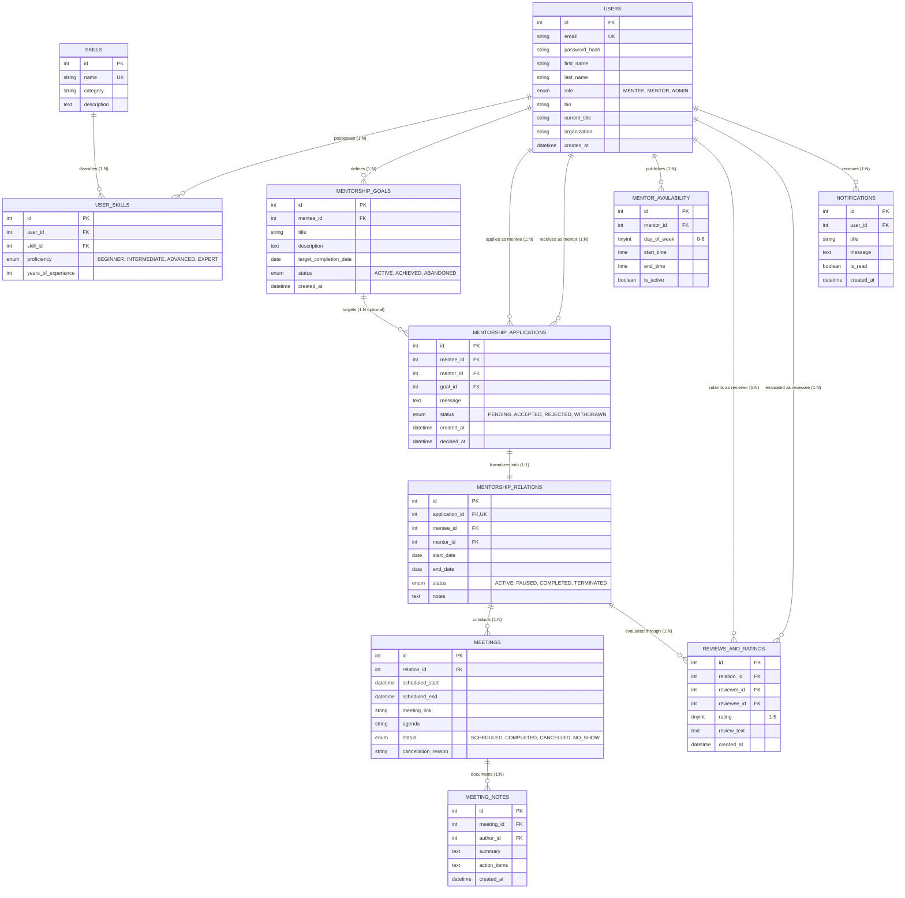

# BBF 302E Database Systems — Fall 2026
## Milestone 2: ER Diagram, Relational Schema Mapping, Normalization & Query Design

- **Course**: BBF 302E Database Systems (Fall 2026)
- **Team Name**: **Black Swan**
- **Selected Project Topic**: **Mentor–Mentee Matching Platform**
- **Relational DBMS**: **MySQL 8.0+ (InnoDB Storage Engine)** — *Raw Parameterized SQL, Strictly No ORM*
- **Milestone Due Date**: November 15, 2026, 23:59
- **Mandatory TA Meeting Window**: November 30 – December 4, 2026

---

### Team Roster & Module Ownership

| # | Member Name | Student ID | Course Section | Team Role | Primary Database Tables | Complex Query |
| :-: | :--- | :--- | :-: | :--- | :--- | :-: |
| 1 | **Gaffar Dulkadir** | 150210306 | 12495 | **Team Leader** &bull; Mentorship Relations & Availability | `mentorship_relations`<br>`mentor_availability` | **CQ-04**: Availability Occupancy & Utilization |
| 2 | **Denils Mahmuti** | 150230984 | 15742 | Skill Management & Multi-Skill Discovery | `skills`<br>`user_skills` | **CQ-02**: Recommendation Engine |
| 3 | **Ravan Seyfullayev** | 150240928 | 15742 | Authentication, Profiles & Notifications | `users`<br>`notifications` | **CQ-01**: Dashboard Summary Monitor |
| 4 | **Abdullokhon Valikhonov** | 150240942 | 15742 | Mentorship Goals & Application Lifecycle | `mentorship_goals`<br>`mentorship_applications` | **CQ-03**: Goal Progress & Activity Correlation |
| 5 | **Raimbek Erik** | 150230932 | 15742 | Sessions, Meeting Notes & Reviews | `meetings`<br>`reviews_and_ratings`<br>*(aux: `meeting_notes`)* | **CQ-05**: Mentor Leaderboard & Analytics |

---

## 1. Data Requirements Aligned with Functional Requirements

The data requirements directly fulfill the functional requirements (FR-01 through FR-15) established in Milestone 1:

| Req ID | Functional Requirement Summary | Related Entity / Tables | Data Elements Required & Constraints | Responsible Member |
| :---: | :--- | :--- | :--- | :--- |
| **FR-01** | User Registration & Role Selection | `users` | `email` (unique, valid email), `password_hash` (bcrypt), `first_name`, `last_name`, `role` (`MENTEE`, `MENTOR`, `ADMIN`). | Ravan Seyfullayev |
| **FR-02** | Authentication & Session Management | `users` | Secure lookup by `email`, session cookie tokens, login timestamp tracking. | Ravan Seyfullayev |
| **FR-03** | User Profile & Notifications | `users`, `notifications` | `bio`, `current_title`, `organization`; `title`, `message`, `is_read` flag, notification creation timestamp. | Ravan Seyfullayev |
| **FR-04** | Skill Catalog Management | `skills` | Unique skill `name`, `category` (e.g. Backend, AI/ML, Cloud), detailed `description`. | Denils Mahmuti |
| **FR-05** | User Skills & Endorsement | `user_skills`, `skills` | `user_id`, `skill_id`, `proficiency` (`BEGINNER`, `INTERMEDIATE`, `ADVANCED`, `EXPERT`), `years_of_experience` (non-negative). | Denils Mahmuti |
| **FR-06** | Mentor Search & Multi-Skill Filtering | `users`, `user_skills`, `skills` | Indexed join between mentor roles, skill categories, and proficiency tiers for sub-second retrieval. | Denils Mahmuti |
| **FR-07** | Mentee Goal Formulation | `mentorship_goals` | `mentee_id`, `title`, `description`, `target_completion_date`, `status` (`ACTIVE`, `ACHIEVED`, `ABANDONED`). | Abdullokhon Valikhonov |
| **FR-08** | Mentorship Application Submission | `mentorship_applications`, `mentorship_goals` | `mentee_id`, `mentor_id`, optional `goal_id`, motivational `message`, `status` (`PENDING`, `ACCEPTED`, `REJECTED`, `WITHDRAWN`). | Abdullokhon Valikhonov |
| **FR-09** | Application Decision & Review | `mentorship_applications` | Status transition timestamp `decided_at`, mentor verification, atomic status update. | Abdullokhon Valikhonov |
| **FR-10** | Mentorship Relationship Lifecycle | `mentorship_relations` | Formalization of accepted application: `start_date`, `end_date`, `status` (`ACTIVE`, `PAUSED`, `COMPLETED`, `TERMINATED`), supervision `notes`. | Gaffar Dulkadir |
| **FR-11** | Mentor Availability Windows | `mentor_availability` | `mentor_id`, `day_of_week` (0=Sunday to 6=Saturday), `start_time`, `end_time` (`end_time > start_time`), `is_active`. | Gaffar Dulkadir |
| **FR-12** | Meeting Scheduling | `meetings`, `mentorship_relations` | `relation_id`, `scheduled_start`, `scheduled_end` (`scheduled_end > scheduled_start`), `meeting_link`, `agenda`, `status` (`SCHEDULED`). | Raimbek Erik |
| **FR-13** | Meeting Status & Cancellation | `meetings` | Status transitions (`COMPLETED`, `CANCELLED`, `NO_SHOW`), mandatory `cancellation_reason` on cancellation. | Raimbek Erik |
| **FR-14** | Session Notes & Action Items | `meeting_notes`, `meetings` | `meeting_id`, `author_id` (participant), discussion `summary`, markdown `action_items`. | Raimbek Erik |
| **FR-15** | Bidirectional Reviews & Leaderboard | `reviews_and_ratings` | `relation_id`, `reviewer_id`, `reviewee_id`, integer `rating` (1–5 scale), qualitative `review_text`. | Raimbek Erik |

---

## 2. Entity-Relationship (ER) Conceptual Model

### 2.1 Entity Set Descriptions

1. **User**: Represents all participants in the platform categorized into `MENTEE`, `MENTOR`, or `ADMIN`. Holds credentials, contact information, professional title, and organization.
2. **Skill**: Represents standardized competencies in software engineering, data science, project management, and career development.
3. **UserSkill**: Associative entity capturing the N:M relationship between users and skills, enriched with proficiency level and experience duration.
4. **MentorshipGoal**: Represents specific educational or career objectives defined by mentees.
5. **MentorshipApplication**: Represents a formal request submitted by a mentee to a specific mentor, optionally linked to a specific learning goal.
6. **MentorshipRelation**: Formalized long-term mentoring engagement resulting from an accepted application.
7. **MentorAvailability**: Configurable recurring weekly availability windows published by mentors.
8. **Meeting**: Individual 1-on-1 scheduled sessions held under an active mentorship relation.
9. **MeetingNote**: Minutes, summaries, and action items recorded by participants following a meeting.
10. **ReviewAndRating**: Bidirectional post-mentorship evaluation containing 1–5 star ratings and written feedback.
11. **Notification**: Asynchronous alerts sent to users regarding application updates, meeting confirmations, or review reminders.

---

### 2.2 Conceptual ER Diagram



---

### 2.3 Cardinalities & Relationship Rationale

1. **`users` to `user_skills` (1:N) & `skills` to `user_skills` (1:N)**:
   - A user can possess multiple skills; a skill can be shared by multiple users.
   - Decomposed into the associative entity `user_skills` with candidate key `{user_id, skill_id}` to prevent duplicate assignments while recording proficiency and years of experience.
2. **`users` to `mentorship_goals` (1:N)**:
   - A mentee can define zero, one, or many distinct learning goals. Each goal belongs exclusively to one mentee.
3. **`users` (mentee) to `mentorship_applications` (1:N) & `users` (mentor) to `mentorship_applications` (1:N)**:
   - A mentee can submit multiple applications to different mentors; a mentor can receive applications from multiple mentees.
4. **`mentorship_goals` to `mentorship_applications` (1:N optional)**:
   - An application can optionally reference a target goal. If a goal is deleted, the application retains its integrity (`ON DELETE SET NULL`).
5. **`mentorship_applications` to `mentorship_relations` (1:1)**:
   - Each accepted application produces exactly one formalized mentorship relation. Enforced via `UNIQUE(application_id)` on `mentorship_relations`.
6. **`users` (mentor) to `mentor_availability` (1:N)**:
   - A mentor can configure multiple weekly recurring slots across different days of the week.
7. **`mentorship_relations` to `meetings` (1:N)**:
   - A mentorship relation can hold many scheduled sessions over its duration. Each meeting belongs to exactly one relation.
8. **`meetings` to `meeting_notes` (1:N)**:
   - Each meeting can accumulate notes or action items written by either participant (`author_id`).
9. **`mentorship_relations` to `reviews_and_ratings` (1:N)**:
   - Both the mentee and mentor can submit an evaluation for the relation. The compound candidate key `{relation_id, reviewer_id, reviewee_id}` strictly enforces a maximum of one review per participant per relationship.
10. **`users` to `notifications` (1:N)**:
    - A user can receive many system alerts. Deleting a user cascades to remove their notifications.

---

## 3. ER-to-Relational Schema Mapping

Each entity and relationship is mapped to a relational schema with exact MySQL data types, primary keys, candidate keys, foreign keys, and integrity constraints:

### 1. `users` (Responsible: Ravan Seyfullayev)
- **DDL Definition**:
  ```sql
  CREATE TABLE users (
      id INT AUTO_INCREMENT PRIMARY KEY,
      email VARCHAR(150) NOT NULL UNIQUE,
      password_hash VARCHAR(255) NOT NULL,
      first_name VARCHAR(60) NOT NULL,
      last_name VARCHAR(60) NOT NULL,
      role ENUM('MENTEE', 'MENTOR', 'ADMIN') NOT NULL DEFAULT 'MENTEE',
      bio TEXT,
      current_title VARCHAR(100),
      organization VARCHAR(100),
      created_at DATETIME NOT NULL DEFAULT CURRENT_TIMESTAMP,
      INDEX idx_users_role (role),
      INDEX idx_users_email (email)
  ) ENGINE=InnoDB DEFAULT CHARSET=utf8mb4 COLLATE=utf8mb4_unicode_ci;
  ```
- **Primary Key**: `id`
- **Candidate Keys**: `{id}`, `{email}`
- **Foreign Keys**: None
- **Integrity Constraints**: `UNIQUE(email)`, `role IN ('MENTEE', 'MENTOR', 'ADMIN')`.

### 2. `notifications` (Responsible: Ravan Seyfullayev)
- **DDL Definition**:
  ```sql
  CREATE TABLE notifications (
      id INT AUTO_INCREMENT PRIMARY KEY,
      user_id INT NOT NULL,
      title VARCHAR(150) NOT NULL,
      message TEXT NOT NULL,
      is_read BOOLEAN NOT NULL DEFAULT FALSE,
      created_at DATETIME NOT NULL DEFAULT CURRENT_TIMESTAMP,
      CONSTRAINT fk_notifications_user FOREIGN KEY (user_id) 
          REFERENCES users (id) ON DELETE CASCADE,
      INDEX idx_notifications_user_read (user_id, is_read)
  ) ENGINE=InnoDB DEFAULT CHARSET=utf8mb4 COLLATE=utf8mb4_unicode_ci;
  ```
- **Primary Key**: `id`
- **Candidate Keys**: `{id}`
- **Foreign Keys**: `user_id` $\to$ `users(id)` ON DELETE CASCADE.

### 3. `skills` (Responsible: Denils Mahmuti)
- **DDL Definition**:
  ```sql
  CREATE TABLE skills (
      id INT AUTO_INCREMENT PRIMARY KEY,
      name VARCHAR(80) NOT NULL UNIQUE,
      category VARCHAR(60) NOT NULL,
      description TEXT,
      INDEX idx_skills_category (category)
  ) ENGINE=InnoDB DEFAULT CHARSET=utf8mb4 COLLATE=utf8mb4_unicode_ci;
  ```
- **Primary Key**: `id`
- **Candidate Keys**: `{id}`, `{name}`
- **Foreign Keys**: None
- **Integrity Constraints**: `UNIQUE(name)`.

### 4. `user_skills` (Responsible: Denils Mahmuti)
- **DDL Definition**:
  ```sql
  CREATE TABLE user_skills (
      id INT AUTO_INCREMENT PRIMARY KEY,
      user_id INT NOT NULL,
      skill_id INT NOT NULL,
      proficiency ENUM('BEGINNER', 'INTERMEDIATE', 'ADVANCED', 'EXPERT') NOT NULL DEFAULT 'INTERMEDIATE',
      years_of_experience INT NOT NULL DEFAULT 0,
      CONSTRAINT fk_user_skills_user FOREIGN KEY (user_id) 
          REFERENCES users (id) ON DELETE CASCADE,
      CONSTRAINT fk_user_skills_skill FOREIGN KEY (skill_id) 
          REFERENCES skills (id) ON DELETE CASCADE,
      CONSTRAINT uq_user_skill UNIQUE (user_id, skill_id),
      CONSTRAINT chk_years_exp CHECK (years_of_experience >= 0)
  ) ENGINE=InnoDB DEFAULT CHARSET=utf8mb4 COLLATE=utf8mb4_unicode_ci;
  ```
- **Primary Key**: `id`
- **Candidate Keys**: `{id}`, `{user_id, skill_id}`
- **Foreign Keys**: `user_id` $\to$ `users(id)` ON DELETE CASCADE; `skill_id` $\to$ `skills(id)` ON DELETE CASCADE.
- **Integrity Constraints**: `UNIQUE(user_id, skill_id)`, `years_of_experience >= 0`.

### 5. `mentorship_goals` (Responsible: Abdullokhon Valikhonov)
- **DDL Definition**:
  ```sql
  CREATE TABLE mentorship_goals (
      id INT AUTO_INCREMENT PRIMARY KEY,
      mentee_id INT NOT NULL,
      title VARCHAR(150) NOT NULL,
      description TEXT,
      target_completion_date DATE,
      status ENUM('ACTIVE', 'ACHIEVED', 'ABANDONED') NOT NULL DEFAULT 'ACTIVE',
      created_at DATETIME NOT NULL DEFAULT CURRENT_TIMESTAMP,
      CONSTRAINT fk_goals_mentee FOREIGN KEY (mentee_id) 
          REFERENCES users (id) ON DELETE CASCADE,
      INDEX idx_goals_mentee_status (mentee_id, status)
  ) ENGINE=InnoDB DEFAULT CHARSET=utf8mb4 COLLATE=utf8mb4_unicode_ci;
  ```
- **Primary Key**: `id`
- **Candidate Keys**: `{id}`
- **Foreign Keys**: `mentee_id` $\to$ `users(id)` ON DELETE CASCADE.
- **Integrity Constraints**: `status IN ('ACTIVE', 'ACHIEVED', 'ABANDONED')`.

### 6. `mentorship_applications` (Responsible: Abdullokhon Valikhonov)
- **DDL Definition**:
  ```sql
  CREATE TABLE mentorship_applications (
      id INT AUTO_INCREMENT PRIMARY KEY,
      mentee_id INT NOT NULL,
      mentor_id INT NOT NULL,
      goal_id INT NULL,
      message TEXT NOT NULL,
      status ENUM('PENDING', 'ACCEPTED', 'REJECTED', 'WITHDRAWN') NOT NULL DEFAULT 'PENDING',
      created_at DATETIME NOT NULL DEFAULT CURRENT_TIMESTAMP,
      decided_at DATETIME NULL,
      CONSTRAINT fk_app_mentee FOREIGN KEY (mentee_id) 
          REFERENCES users (id) ON DELETE CASCADE,
      CONSTRAINT fk_app_mentor FOREIGN KEY (mentor_id) 
          REFERENCES users (id) ON DELETE CASCADE,
      CONSTRAINT fk_app_goal FOREIGN KEY (goal_id) 
          REFERENCES mentorship_goals (id) ON DELETE SET NULL,
      INDEX idx_app_mentor_status (mentor_id, status),
      INDEX idx_app_mentee_status (mentee_id, status)
  ) ENGINE=InnoDB DEFAULT CHARSET=utf8mb4 COLLATE=utf8mb4_unicode_ci;
  ```
- **Primary Key**: `id`
- **Candidate Keys**: `{id}`
- **Foreign Keys**: `mentee_id` $\to$ `users(id)` ON DELETE CASCADE; `mentor_id` $\to$ `users(id)` ON DELETE CASCADE; `goal_id` $\to$ `mentorship_goals(id)` ON DELETE SET NULL.
- **Integrity Constraints**: `status IN ('PENDING', 'ACCEPTED', 'REJECTED', 'WITHDRAWN')`.

### 7. `mentorship_relations` (Responsible: Gaffar Dulkadir)
- **DDL Definition**:
  ```sql
  CREATE TABLE mentorship_relations (
      id INT AUTO_INCREMENT PRIMARY KEY,
      application_id INT NOT NULL UNIQUE,
      mentee_id INT NOT NULL,
      mentor_id INT NOT NULL,
      start_date DATE NOT NULL,
      end_date DATE NULL,
      status ENUM('ACTIVE', 'PAUSED', 'COMPLETED', 'TERMINATED') NOT NULL DEFAULT 'ACTIVE',
      notes TEXT,
      CONSTRAINT fk_rel_application FOREIGN KEY (application_id) 
          REFERENCES mentorship_applications (id) ON DELETE RESTRICT,
      CONSTRAINT fk_rel_mentee FOREIGN KEY (mentee_id) 
          REFERENCES users (id) ON DELETE RESTRICT,
      CONSTRAINT fk_rel_mentor FOREIGN KEY (mentor_id) 
          REFERENCES users (id) ON DELETE RESTRICT,
      INDEX idx_rel_mentor_status (mentor_id, status),
      INDEX idx_rel_mentee_status (mentee_id, status)
  ) ENGINE=InnoDB DEFAULT CHARSET=utf8mb4 COLLATE=utf8mb4_unicode_ci;
  ```
- **Primary Key**: `id`
- **Candidate Keys**: `{id}`, `{application_id}`
- **Foreign Keys**: `application_id` $\to$ `mentorship_applications(id)` ON DELETE RESTRICT; `mentee_id` $\to$ `users(id)` ON DELETE RESTRICT; `mentor_id` $\to$ `users(id)` ON DELETE RESTRICT.
- **Integrity Constraints**: `UNIQUE(application_id)`, `ON DELETE RESTRICT` guarantees active relation histories are never deleted accidentally.

### 8. `mentor_availability` (Responsible: Gaffar Dulkadir)
- **DDL Definition**:
  ```sql
  CREATE TABLE mentor_availability (
      id INT AUTO_INCREMENT PRIMARY KEY,
      mentor_id INT NOT NULL,
      day_of_week TINYINT NOT NULL,
      start_time TIME NOT NULL,
      end_time TIME NOT NULL,
      is_active BOOLEAN NOT NULL DEFAULT TRUE,
      CONSTRAINT fk_avail_mentor FOREIGN KEY (mentor_id) 
          REFERENCES users (id) ON DELETE CASCADE,
      CONSTRAINT chk_day_of_week CHECK (day_of_week BETWEEN 0 AND 6),
      CONSTRAINT chk_avail_times CHECK (end_time > start_time),
      INDEX idx_avail_mentor_day (mentor_id, day_of_week, is_active)
  ) ENGINE=InnoDB DEFAULT CHARSET=utf8mb4 COLLATE=utf8mb4_unicode_ci;
  ```
- **Primary Key**: `id`
- **Candidate Keys**: `{id}`
- **Foreign Keys**: `mentor_id` $\to$ `users(id)` ON DELETE CASCADE.
- **Integrity Constraints**: `day_of_week BETWEEN 0 AND 6`, `end_time > start_time`.

### 9. `meetings` (Responsible: Raimbek Erik)
- **DDL Definition**:
  ```sql
  CREATE TABLE meetings (
      id INT AUTO_INCREMENT PRIMARY KEY,
      relation_id INT NOT NULL,
      scheduled_start DATETIME NOT NULL,
      scheduled_end DATETIME NOT NULL,
      meeting_link VARCHAR(255),
      agenda TEXT,
      status ENUM('SCHEDULED', 'COMPLETED', 'CANCELLED', 'NO_SHOW') NOT NULL DEFAULT 'SCHEDULED',
      cancellation_reason VARCHAR(255),
      CONSTRAINT fk_meetings_relation FOREIGN KEY (relation_id) 
          REFERENCES mentorship_relations (id) ON DELETE CASCADE,
      CONSTRAINT chk_meeting_times CHECK (scheduled_end > scheduled_start),
      INDEX idx_meetings_rel_start (relation_id, scheduled_start)
  ) ENGINE=InnoDB DEFAULT CHARSET=utf8mb4 COLLATE=utf8mb4_unicode_ci;
  ```
- **Primary Key**: `id`
- **Candidate Keys**: `{id}`
- **Foreign Keys**: `relation_id` $\to$ `mentorship_relations(id)` ON DELETE CASCADE.
- **Integrity Constraints**: `scheduled_end > scheduled_start`, `status IN ('SCHEDULED', 'COMPLETED', 'CANCELLED', 'NO_SHOW')`.

### 10. `reviews_and_ratings` (Responsible: Raimbek Erik)
- **DDL Definition**:
  ```sql
  CREATE TABLE reviews_and_ratings (
      id INT AUTO_INCREMENT PRIMARY KEY,
      relation_id INT NOT NULL,
      reviewer_id INT NOT NULL,
      reviewee_id INT NOT NULL,
      rating TINYINT NOT NULL,
      review_text TEXT,
      created_at DATETIME NOT NULL DEFAULT CURRENT_TIMESTAMP,
      CONSTRAINT fk_reviews_relation FOREIGN KEY (relation_id) 
          REFERENCES mentorship_relations (id) ON DELETE CASCADE,
      CONSTRAINT fk_reviews_reviewer FOREIGN KEY (reviewer_id) 
          REFERENCES users (id) ON DELETE CASCADE,
      CONSTRAINT fk_reviews_reviewee FOREIGN KEY (reviewee_id) 
          REFERENCES users (id) ON DELETE CASCADE,
      CONSTRAINT chk_rating_range CHECK (rating BETWEEN 1 AND 5),
      CONSTRAINT uq_relation_review UNIQUE (relation_id, reviewer_id, reviewee_id)
  ) ENGINE=InnoDB DEFAULT CHARSET=utf8mb4 COLLATE=utf8mb4_unicode_ci;
  ```
- **Primary Key**: `id`
- **Candidate Keys**: `{id}`, `{relation_id, reviewer_id, reviewee_id}`
- **Foreign Keys**: `relation_id` $\to$ `mentorship_relations(id)` ON DELETE CASCADE; `reviewer_id` $\to$ `users(id)` ON DELETE CASCADE; `reviewee_id` $\to$ `users(id)` ON DELETE CASCADE.
- **Integrity Constraints**: `rating BETWEEN 1 AND 5`, `UNIQUE(relation_id, reviewer_id, reviewee_id)`.

### 11. `meeting_notes` (Auxiliary Table — Responsible: Raimbek Erik)
- **DDL Definition**:
  ```sql
  CREATE TABLE meeting_notes (
      id INT AUTO_INCREMENT PRIMARY KEY,
      meeting_id INT NOT NULL,
      author_id INT NOT NULL,
      summary TEXT NOT NULL,
      action_items TEXT,
      created_at DATETIME NOT NULL DEFAULT CURRENT_TIMESTAMP,
      CONSTRAINT fk_notes_meeting FOREIGN KEY (meeting_id) 
          REFERENCES meetings (id) ON DELETE CASCADE,
      CONSTRAINT fk_notes_author FOREIGN KEY (author_id) 
          REFERENCES users (id) ON DELETE CASCADE
  ) ENGINE=InnoDB DEFAULT CHARSET=utf8mb4 COLLATE=utf8mb4_unicode_ci;
  ```
- **Primary Key**: `id`
- **Candidate Keys**: `{id}`
- **Foreign Keys**: `meeting_id` $\to$ `meetings(id)` ON DELETE CASCADE; `author_id` $\to$ `users(id)` ON DELETE CASCADE.

---

## 4. Formal Normalization Analysis (3NF & BCNF Proofs)

A database schema is tested against normal forms to guarantee the absence of data redundancy, insertion anomalies, update anomalies, and deletion anomalies.

### 4.1 Theoretical Foundations
- **First Normal Form (1NF)**: Every attribute contains only atomic (indivisible) values, and there are no repeating groups or multivalued attributes.
- **Second Normal Form (2NF)**: The relation is in 1NF, and every non-prime attribute is fully functionally dependent on the primary key (no partial key dependencies on proper subsets of candidate keys).
- **Third Normal Form (3NF)**: The relation is in 2NF, and for every non-trivial functional dependency $X \to Y$, either:
  1. $X$ is a superkey, or
  2. $Y$ is a prime attribute (part of a candidate key).
  *(Equivalently: no transitive dependency of non-prime attributes on candidate keys).*
- **Boyce-Codd Normal Form (BCNF)**: For every non-trivial functional dependency $X \to Y$, $X$ must be a superkey. BCNF strictly eliminates all anomalies arising from functional dependencies.

---

### 4.2 Table-by-Table Verification

#### 1. `users`
- **Candidate Keys**: $\{id\}$, $\{email\}$
- **Non-trivial FDs**:
  - $id \to \{email, password\_hash, first\_name, last\_name, role, bio, current\_title, organization, created\_at\}$
  - $email \to \{id, password\_hash, first\_name, last\_name, role, bio, current\_title, organization, created\_at\}$
- **Analysis**:
  - Both $\{id\}$ and $\{email\}$ are candidate keys (superkeys).
  - Every determinant is a superkey.
  - No transitive dependencies exist (e.g. `organization` does not determine `current_title`).
- **Conclusion**: **Satisfies 3NF and BCNF**.

#### 2. `skills`
- **Candidate Keys**: $\{id\}$, $\{name\}$
- **Non-trivial FDs**:
  - $id \to \{name, category, description\}$
  - $name \to \{id, category, description\}$
- **Analysis**:
  - Both determinants are superkeys.
  - A skill category does not uniquely determine skill name or description.
- **Conclusion**: **Satisfies 3NF and BCNF**.

#### 3. `user_skills`
- **Candidate Keys**: $\{id\}$, $\{user\_id, skill\_id\}$
- **Non-trivial FDs**:
  - $id \to \{user\_id, skill\_id, proficiency, years\_of\_experience\}$
  - $\{user\_id, skill\_id\} \to \{id, proficiency, years\_of\_experience\}$
- **Analysis**:
  - The non-prime attributes `proficiency` and `years_of_experience` depend on the *conjunction* of both `user_id` and `skill_id`. Neither attribute depends on `user_id` alone or `skill_id` alone (no partial key dependency $\implies$ 2NF holds).
  - In every non-trivial FD, the left-hand side determinant is a superkey.
- **Conclusion**: **Satisfies 3NF and BCNF**.

#### 4. `mentorship_goals`
- **Candidate Keys**: $\{id\}$
- **Non-trivial FDs**:
  - $id \to \{mentee\_id, title, description, target\_completion\_date, status, created\_at\}$
- **Analysis**:
  - Single-attribute primary key $\implies$ partial key dependency is mathematically impossible ($\implies$ 2NF holds).
  - No non-prime attribute determines any other non-prime attribute (e.g., `target_completion_date` does not determine `status` or `title`).
  - The determinant $\{id\}$ is a superkey.
- **Conclusion**: **Satisfies 3NF and BCNF**.

#### 5. `mentorship_applications`
- **Candidate Keys**: $\{id\}$
- **Non-trivial FDs**:
  - $id \to \{mentee\_id, mentor\_id, goal\_id, message, status, created\_at, decided\_at\}$
- **Analysis**:
  - Primary key is atomic ($\{id\}$).
  - No functional dependency exists among the non-key attributes (e.g., `goal_id` does not determine `mentor_id`, nor does `status` determine `message`).
  - Every non-trivial FD has a superkey determinant.
- **Conclusion**: **Satisfies 3NF and BCNF**.

#### 6. `mentorship_relations`
- **Candidate Keys**: $\{id\}$, $\{application\_id\}$
- **Non-trivial FDs**:
  - $id \to \{application\_id, mentee\_id, mentor\_id, start\_date, end\_date, status, notes\}$
  - $application\_id \to \{id, mentee\_id, mentor\_id, start\_date, end\_date, status, notes\}$
- **Analysis**:
  - Because `application_id` is unique, both $\{id\}$ and $\{application\_id\}$ are candidate keys.
  - Every determinant is a candidate key / superkey.
  - Mentee and mentor combinations do not uniquely determine dates or status because historical completed relations can exist.
- **Conclusion**: **Satisfies 3NF and BCNF**.

#### 7. `mentor_availability`
- **Candidate Keys**: $\{id\}$
- **Non-trivial FDs**:
  - $id \to \{mentor\_id, day\_of\_week, start\_time, end\_time, is\_active\}$
- **Analysis**:
  - A mentor can have multiple distinct availability blocks on the same day of the week. Therefore, $\{mentor\_id, day\_of\_week\}$ is not a key.
  - The single attribute $\{id\}$ uniquely determines all other fields.
  - The determinant is a superkey.
- **Conclusion**: **Satisfies 3NF and BCNF**.

#### 8. `meetings`
- **Candidate Keys**: $\{id\}$
- **Non-trivial FDs**:
  - $id \to \{relation\_id, scheduled\_start, scheduled\_end, meeting\_link, agenda, status, cancellation\_reason\}$
- **Analysis**:
  - The determinant $\{id\}$ is a superkey.
  - `cancellation_reason` is conditionally present based on status but does not determine any attribute; no functional dependency exists between non-prime attributes.
- **Conclusion**: **Satisfies 3NF and BCNF**.

#### 9. `reviews_and_ratings`
- **Candidate Keys**: $\{id\}$, $\{relation\_id, reviewer\_id, reviewee\_id\}$
- **Non-trivial FDs**:
  - $id \to \{relation\_id, reviewer\_id, reviewee\_id, rating, review\_text, created\_at\}$
  - $\{relation\_id, reviewer\_id, reviewee\_id\} \to \{id, rating, review\_text, created\_at\}$
- **Analysis**:
  - Both determinants are superkeys.
  - The non-prime attributes `rating` and `review_text` depend on the specific evaluation submitted by that reviewer for that relation.
  - In all dependencies, determinants are superkeys.
- **Conclusion**: **Satisfies 3NF and BCNF**.

#### 10. `meeting_notes` & `notifications`
- **Candidate Keys**: $\{id\}$
- **Non-trivial FDs**:
  - In both tables: $id \to \text{all other attributes}$.
- **Analysis**:
  - Single-attribute primary keys with no partial or transitive dependencies.
- **Conclusion**: **Both satisfy 3NF and BCNF**.

---

### 4.3 Summary of Normalization Proof
All 11 tables in the relational database model satisfy the criteria for **Third Normal Form (3NF)** and **Boyce-Codd Normal Form (BCNF)**. No update, insertion, or deletion anomalies can occur under this schema design.

---

## 5. CRUD Operation Planning

The application provides web-based UI forms and views for full CRUD operations across all main entities. Database interactions occur via raw parameterized SQL executed through Python's `mysql-connector-python` cursor:

| Entity | Operation | Web Route / Trigger | SQL Action Executed | Parameters / Inputs |
| :--- | :---: | :--- | :--- | :--- |
| **`users`** | **C** | `POST /register` | `INSERT INTO users (email, password_hash, first_name, last_name, role) VALUES (%s, %s, %s, %s, %s)` | Email, bcrypt hash, names, role |
| | **R** | `GET /login`, `GET /profile` | `SELECT id, email, password_hash, role, bio FROM users WHERE email = %s` | Email or user ID |
| | **U** | `POST /profile/edit` | `UPDATE users SET first_name=%s, last_name=%s, bio=%s, current_title=%s, organization=%s WHERE id=%s` | Profile form data, session user ID |
| | **D** | `POST /admin/users/<id>/delete` | `DELETE FROM users WHERE id = %s` | Admin access only; cascades to profile data |
| **`skills`** | **C** | `POST /admin/skills/new` | `INSERT INTO skills (name, category, description) VALUES (%s, %s, %s)` | Name, category, description |
| | **R** | `GET /skills` | `SELECT s.id, s.name, s.category, s.description, COUNT(us.id) AS user_count FROM skills s LEFT JOIN user_skills us ON s.id = us.skill_id GROUP BY s.id` | Filter params (category, search query) |
| | **U** | `POST /admin/skills/<id>/edit` | `UPDATE skills SET name=%s, category=%s, description=%s WHERE id=%s` | Updated skill fields |
| | **D** | `POST /admin/skills/<id>/delete` | `DELETE FROM skills WHERE id = %s` | Admin confirmation; cascades to `user_skills` |
| **`user_skills`** | **C** | `POST /profile/skills/add` | `INSERT INTO user_skills (user_id, skill_id, proficiency, years_of_experience) VALUES (%s, %s, %s, %s)` | Selected skill ID, proficiency enum, years |
| | **R** | `GET /profile`, `GET /mentors/<id>` | `SELECT us.id, s.name, s.category, us.proficiency, us.years_of_experience FROM user_skills us JOIN skills s ON us.skill_id = s.id WHERE us.user_id = %s` | User ID |
| | **U** | `POST /profile/skills/<id>/edit` | `UPDATE user_skills SET proficiency=%s, years_of_experience=%s WHERE id=%s AND user_id=%s` | Updated proficiency and years |
| | **D** | `POST /profile/skills/<id>/delete` | `DELETE FROM user_skills WHERE id=%s AND user_id=%s` | Record ID, verified user ID |
| **`mentorship_goals`** | **C** | `POST /goals/new` | `INSERT INTO mentorship_goals (mentee_id, title, description, target_completion_date, status) VALUES (%s, %s, %s, %s, 'ACTIVE')` | Form fields, mentee session ID |
| | **R** | `GET /goals` | `SELECT id, title, description, target_completion_date, status FROM mentorship_goals WHERE mentee_id = %s ORDER BY created_at DESC` | Mentee user ID |
| | **U** | `POST /goals/<id>/edit` | `UPDATE mentorship_goals SET title=%s, description=%s, target_completion_date=%s, status=%s WHERE id=%s AND mentee_id=%s` | Goal update form |
| | **D** | `POST /goals/<id>/delete` | `DELETE FROM mentorship_goals WHERE id=%s AND mentee_id=%s` | Goal ID, mentee session ID |
| **`mentorship_applications`** | **C** | `POST /apply/<mentor_id>` | `INSERT INTO mentorship_applications (mentee_id, mentor_id, goal_id, message, status) VALUES (%s, %s, %s, %s, 'PENDING')` | Mentee ID, mentor ID, goal ID, message |
| | **R** | `GET /applications` | `SELECT ma.id, ma.status, ma.message, ma.created_at, u.first_name, u.last_name, mg.title AS goal_title FROM mentorship_applications ma JOIN users u ON ma.mentor_id = u.id LEFT JOIN mentorship_goals mg ON ma.goal_id = mg.id WHERE ma.mentee_id = %s` | Applicant or recipient ID |
| | **U** | `POST /applications/<id>/decision` | `UPDATE mentorship_applications SET status=%s, decided_at=NOW() WHERE id=%s AND mentor_id=%s` | Decision (`ACCEPTED` / `REJECTED`) |
| | **D** | `POST /applications/<id>/withdraw` | `UPDATE mentorship_applications SET status='WITHDRAWN' WHERE id=%s AND mentee_id=%s AND status='PENDING'` | Application ID, mentee ID |
| **`mentorship_relations`** | **C** | Triggered on application accept | `INSERT INTO mentorship_relations (application_id, mentee_id, mentor_id, start_date, status) VALUES (%s, %s, %s, CURRENT_DATE, 'ACTIVE')` | Application data inside ACID transaction |
| | **R** | `GET /relations`, `GET /relations/<id>` | `SELECT mr.*, mtr.first_name AS mentor_name, mte.first_name AS mentee_name FROM mentorship_relations mr JOIN users mtr ON mr.mentor_id = mtr.id JOIN users mte ON mr.mentee_id = mte.id WHERE mr.id = %s` | Relation ID, participant check |
| | **U** | `POST /relations/<id>/status` | `UPDATE mentorship_relations SET status=%s, end_date=%s, notes=%s WHERE id=%s` | Updated lifecycle status (`COMPLETED`, `PAUSED`, etc.) |
| | **D** | Admin intervention | `DELETE FROM mentorship_relations WHERE id=%s` | Restricted foreign keys prevent orphaned records |
| **`mentor_availability`** | **C** | `POST /availability/new` | `INSERT INTO mentor_availability (mentor_id, day_of_week, start_time, end_time, is_active) VALUES (%s, %s, %s, %s, TRUE)` | Day of week, start, end times |
| | **R** | `GET /availability` | `SELECT id, day_of_week, start_time, end_time, is_active FROM mentor_availability WHERE mentor_id = %s ORDER BY day_of_week, start_time` | Mentor user ID |
| | **U** | `POST /availability/<id>/toggle` | `UPDATE mentor_availability SET is_active = NOT is_active WHERE id = %s AND mentor_id = %s` | Slot ID, mentor ID |
| | **D** | `POST /availability/<id>/delete` | `DELETE FROM mentor_availability WHERE id = %s AND mentor_id = %s` | Slot ID, mentor ID |
| **`meetings`** | **C** | `POST /meetings/book` | `INSERT INTO meetings (relation_id, scheduled_start, scheduled_end, meeting_link, agenda, status) VALUES (%s, %s, %s, %s, %s, 'SCHEDULED')` | Booking form, relationship ID |
| | **R** | `GET /meetings` | `SELECT m.*, u.first_name, u.last_name FROM meetings m JOIN mentorship_relations mr ON m.relation_id = mr.id JOIN users u ON ... WHERE mr.mentee_id = %s OR mr.mentor_id = %s` | User ID, date range filter |
| | **U** | `POST /meetings/<id>/complete` | `UPDATE meetings SET status='COMPLETED' WHERE id=%s` | Meeting ID |
| | **D** | `POST /meetings/<id>/cancel` | `UPDATE meetings SET status='CANCELLED', cancellation_reason=%s WHERE id=%s` | Cancellation form reason |
| **`reviews_and_ratings`** | **C** | `POST /relations/<id>/review` | `INSERT INTO reviews_and_ratings (relation_id, reviewer_id, reviewee_id, rating, review_text) VALUES (%s, %s, %s, %s, %s)` | 1-5 rating, review text |
| | **R** | `GET /leaderboard`, `GET /mentors/<id>` | `SELECT rr.rating, rr.review_text, rr.created_at, u.first_name, u.last_name FROM reviews_and_ratings rr JOIN users u ON rr.reviewer_id = u.id WHERE rr.reviewee_id = %s` | Reviewee ID |
| | **U** | `POST /reviews/<id>/edit` | `UPDATE reviews_and_ratings SET rating=%s, review_text=%s WHERE id=%s AND reviewer_id=%s` | Updated feedback |
| | **D** | `POST /reviews/<id>/delete` | `DELETE FROM reviews_and_ratings WHERE id=%s AND (reviewer_id=%s OR %s='ADMIN')` | Review ID, authorization check |

---

## 6. Complex Query Planning

The system implements 5 specialized complex queries demonstrating advanced SQL operations: multi-table joins, outer joins, nested correlated subqueries, derived tables, date arithmetic, and conditional aggregations:

### CQ-01: Personal Dashboard Summary & Activity Monitor
- **Responsible Member**: **Ravan Seyfullayev** (150240928)
- **Tables Involved**: `users`, `notifications`, `mentorship_applications`, `mentorship_relations`, `meetings`
- **Purpose**: Computes an all-in-one personalized summary for the logged-in user dashboard in a single query: unread notifications count, pending applications count, active relations count, and confirmed sessions scheduled in the next 7 days.
- **Relational Operations**: Correlated scalar subqueries referencing the parent user, date arithmetic (`DATE_ADD`, `NOW()`), and multi-table inner joins.

### CQ-02: Multi-Criteria Mentor Recommendation Engine
- **Responsible Member**: **Denils Mahmuti** (150230984)
- **Tables Involved**: `users`, `user_skills`, `skills`, `reviews_and_ratings`, `mentorship_relations`
- **Purpose**: Ranks prospective mentors for a mentee based on: (1) count of overlapping skills, (2) weighted average mentor proficiency across matched skills, (3) historical review rating, while filtering out mentors who have already reached maximum active mentee capacity ($\ge 5$).
- **Relational Operations**: Multi-table `INNER JOIN`, `LEFT JOIN` with pre-aggregated derived table, subqueries with `HAVING`, `CASE` expression for proficiency mapping, `GROUP BY`, and multi-column `ORDER BY`.

### CQ-03: Mentee Goal Progress & Activity Correlation
- **Responsible Member**: **Abdullokhon Valikhonov** (150240942)
- **Tables Involved**: `mentorship_goals`, `mentorship_applications`, `mentorship_relations`, `users`, `meetings`
- **Purpose**: For each goal of a mentee, computes whether an application was accepted into a relationship, the assigned mentor name, total completed mentoring sessions held under that relationship, date of the most recent session, and days remaining until target completion date.
- **Relational Operations**: Multi-tier outer join tree (`LEFT JOIN` across 5 relational levels), date arithmetic (`DATEDIFF`), aggregation (`COUNT(DISTINCT ...)`, `MAX(...)`), and temporal sorting.

### CQ-04: Mentor Weekly Utilization & Availability Analysis
- **Responsible Member**: **Gaffar Dulkadir** (150210306)
- **Tables Involved**: `users`, `mentor_availability`, `mentorship_relations`, `meetings`
- **Purpose**: Evaluates mentor scheduling utilization by comparing published weekly availability hours against booked meeting hours scheduled for the upcoming period.
- **Relational Operations**: Independent aggregated subqueries joined on mentor ID, date/time arithmetic (`TIMEDIFF`, `TIME_TO_SEC`, `TIMESTAMPDIFF`), and safe division using `NULLIF` to guard against zero-division errors.

### CQ-05: Mentor Leaderboard & Multi-Dimensional Analytics
- **Responsible Member**: **Raimbek Erik** (150230932)
- **Tables Involved**: `users`, `mentorship_relations`, `meetings`, `reviews_and_ratings`
- **Purpose**: Powers the platform's public leaderboard, ranking mentors based on average rating, total completed meetings held, total active mentorships, and count of reviews received.
- **Relational Operations**: `INNER JOIN`, multiple conditional `LEFT JOIN`s, conditional aggregation (`SUM(CASE WHEN ...)`), `COUNT(DISTINCT ...)`, `AVG(...)`, and composite `GROUP BY` with `HAVING`.

---

## 7. Data Population Planning

To simulate realistic usage scenarios and satisfy the project evaluation criteria, a two-tier data generation strategy is used:

### Tier 1: Curated Deterministic Baseline Seed (`sql/02_seed_data.sql`)
- Contains structured initial data for development, testing, and presentation verification:
  - **Deterministic Test Accounts**:
    - Admin: `admin@mentor.itu.edu.tr`
    - Mentors: `mentor@mentor.itu.edu.tr`, `ayse.kaya@itu.edu.tr`, `mehmet.oz@itu.edu.tr`, `zeynep.demir@itu.edu.tr`
    - Mentees: `mentee@mentor.itu.edu.tr`, `can.yildiz@itu.edu.tr`, `elif.sahin@itu.edu.tr`, `burak.celik@itu.edu.tr`
  - **Standardized Skill Taxonomy**: 15 core skills categorized under Software Development, Machine Learning & AI, Cloud & DevOps, Database Systems, and Career Guidance.
  - **Relationships, Meetings & Reviews**: Pre-configured active and completed mentorship relations with meeting schedules, session notes, and reviews enabling immediate out-of-the-box UI demonstration.

### Tier 2: Large-Scale Synthetic Data Generator (`seed_faker.py`)
- Python script leveraging the `Faker` library to populate the database with realistic scale:
  - **Volume**:
    - **300+ Users**: Skewed distribution (70% Mentees, 25% Mentors, 5% Admins) with realistic names, university/tech company affiliations, and bios.
    - **60+ Skills**: Spanning 8 technical and professional categories.
    - **1,200+ User Skills**: Realistic proficiency distributions (`BEGINNER` through `EXPERT`) and verified experience ranges.
    - **250+ Mentorship Goals**: Defined with realistic target dates and active/achieved states.
    - **350+ Applications**: Distributed across `PENDING`, `ACCEPTED`, `REJECTED`, and `WITHDRAWN`.
    - **150+ Mentorship Relations**: Formed exclusively from accepted applications with valid date intervals.
    - **500+ Meetings & Notes**: Scheduled across mentor availability windows with realistic agendas, links, and completion statuses.
    - **300+ Reviews & Ratings**: 1–5 star ratings reflecting authentic performance variance.
  - **Integrity Guarantee**: All generated records strictly adhere to foreign key constraints, temporal ordering (`end_time > start_time`, `decided_at >= created_at`), and enum domains.

---

## 8. Development & Version Control Compliance

In accordance with course guidelines:
1. **GitHub Repository**: All source code, DDL, queries, and documentation are maintained at `https://github.com/Abdullahon2006/mentor-platform`.
2. **Individual Contributions**: Each team member is responsible for committing code for their assigned tables, CRUD routes, and complex queries using their individual GitHub accounts.
3. **Branching Strategy**: Milestone 2 and Milestone 3 features are developed on dedicated feature branches (`feature/milestone2`) and peer-reviewed before merging into `main`.
4. **No ORM / Pure SQL**: Every database interaction uses parameterized raw SQL queries via MySQL cursor (`mysql-connector-python`), strictly adhering to course policy.
