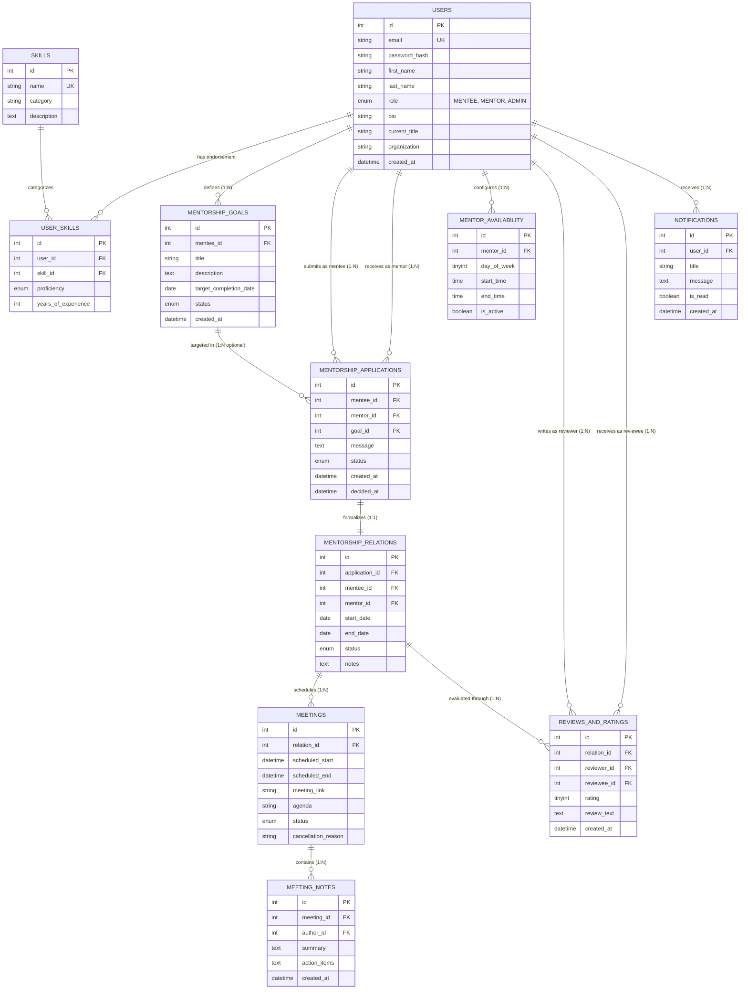

# BBF 302E Database Systems — Fall 2026
## Milestone 2: ER Diagram, Relational Mapping & Normalization Analysis

**Project Topic**: Mentor–Mentee Matching Platform  
**Relational DBMS**: MySQL 8.0+ (InnoDB Storage Engine)

---

## 1. Entity-Relationship (ER) Conceptual Model

### 1.1 Entities & Attribute Classification

| Entity | Primary Key (PK) | Attributes | Description |
| :--- | :--- | :--- | :--- |
| **User** | `id` | `email`, `password_hash`, `first_name`, `last_name`, `role`, `bio`, `current_title`, `organization`, `created_at` | System users categorized as Mentee, Mentor, or Admin. |
| **Skill** | `id` | `name`, `category`, `description` | Standardized technical and professional mentoring competencies. |
| **Goal** | `id` | `mentee_id`, `title`, `description`, `target_completion_date`, `status`, `created_at` | Learning milestones set by mentees. |
| **Application** | `id` | `mentee_id`, `mentor_id`, `goal_id`, `message`, `status`, `created_at`, `decided_at` | Formal connection requests from mentees to mentors. |
| **Relationship** | `id` | `application_id`, `mentee_id`, `mentor_id`, `start_date`, `end_date`, `status`, `notes` | Formalized active or historic mentorship partnerships. |
| **Availability** | `id` | `mentor_id`, `day_of_week`, `start_time`, `end_time`, `is_active` | Recurring weekly availability windows declared by mentors. |
| **Meeting** | `id` | `relation_id`, `scheduled_start`, `scheduled_end`, `meeting_link`, `agenda`, `status`, `cancellation_reason` | 1-on-1 scheduled sessions under an active relationship. |
| **MeetingNote** | `id` | `meeting_id`, `author_id`, `summary`, `action_items`, `created_at` | Minutes, takeaways, and action items recorded per meeting. |
| **Review** | `id` | `relation_id`, `reviewer_id`, `reviewee_id`, `rating`, `review_text`, `created_at` | Qualitative reviews and 1–5 star ratings exchanged post-mentorship. |
| **Notification** | `id` | `user_id`, `title`, `message`, `is_read`, `created_at` | In-app alerts for status changes and reminders. |

---

### 1.2 Relationship Sets & Cardinalities

---

## 2. Mapping of ER Model to Relational Schema

### 1. `users`
- **Schema**: `users(id, email, password_hash, first_name, last_name, role, bio, current_title, organization, created_at)`
- **Primary Key**: `id`
- **Candidate Keys**: `{id}`, `{email}`
- **Foreign Keys**: None
- **Constraints**: `UNIQUE(email)`, `role IN ('MENTEE', 'MENTOR', 'ADMIN')`

### 2. `notifications`
- **Schema**: `notifications(id, user_id, title, message, is_read, created_at)`
- **Primary Key**: `id`
- **Candidate Keys**: `{id}`
- **Foreign Keys**: `user_id` $\to$ `users(id)` ON DELETE CASCADE
- **Constraints**: `is_read DEFAULT FALSE`

### 3. `skills`
- **Schema**: `skills(id, name, category, description)`
- **Primary Key**: `id`
- **Candidate Keys**: `{id}`, `{name}`
- **Foreign Keys**: None
- **Constraints**: `UNIQUE(name)`

### 4. `user_skills`
- **Schema**: `user_skills(id, user_id, skill_id, proficiency, years_of_experience)`
- **Primary Key**: `id`
- **Candidate Keys**: `{id}`, `{user_id, skill_id}`
- **Foreign Keys**:
  - `user_id` $\to$ `users(id)` ON DELETE CASCADE
  - `skill_id` $\to$ `skills(id)` ON DELETE CASCADE
- **Constraints**: `UNIQUE(user_id, skill_id)`, `CHECK(years_of_experience >= 0)`

### 5. `mentorship_goals`
- **Schema**: `mentorship_goals(id, mentee_id, title, description, target_completion_date, status, created_at)`
- **Primary Key**: `id`
- **Candidate Keys**: `{id}`
- **Foreign Keys**: `mentee_id` $\to$ `users(id)` ON DELETE CASCADE
- **Constraints**: `status IN ('ACTIVE', 'ACHIEVED', 'ABANDONED')`

### 6. `mentorship_applications`
- **Schema**: `mentorship_applications(id, mentee_id, mentor_id, goal_id, message, status, created_at, decided_at)`
- **Primary Key**: `id`
- **Candidate Keys**: `{id}`
- **Foreign Keys**:
  - `mentee_id` $\to$ `users(id)` ON DELETE CASCADE
  - `mentor_id` $\to$ `users(id)` ON DELETE CASCADE
  - `goal_id` $\to$ `mentorship_goals(id)` ON DELETE SET NULL
- **Constraints**: `status IN ('PENDING', 'ACCEPTED', 'REJECTED', 'WITHDRAWN')`

### 7. `mentorship_relations`
- **Schema**: `mentorship_relations(id, application_id, mentee_id, mentor_id, start_date, end_date, status, notes)`
- **Primary Key**: `id`
- **Candidate Keys**: `{id}`, `{application_id}`
- **Foreign Keys**:
  - `application_id` $\to$ `mentorship_applications(id)` ON DELETE RESTRICT
  - `mentee_id` $\to$ `users(id)` ON DELETE RESTRICT
  - `mentor_id` $\to$ `users(id)` ON DELETE RESTRICT
- **Constraints**: `UNIQUE(application_id)`, `status IN ('ACTIVE', 'PAUSED', 'COMPLETED', 'TERMINATED')`

### 8. `mentor_availability`
- **Schema**: `mentor_availability(id, mentor_id, day_of_week, start_time, end_time, is_active)`
- **Primary Key**: `id`
- **Candidate Keys**: `{id}`
- **Foreign Keys**: `mentor_id` $\to$ `users(id)` ON DELETE CASCADE
- **Constraints**: `CHECK(day_of_week BETWEEN 0 AND 6)`, `CHECK(end_time > start_time)`

### 9. `meetings`
- **Schema**: `meetings(id, relation_id, scheduled_start, scheduled_end, meeting_link, agenda, status, cancellation_reason)`
- **Primary Key**: `id`
- **Candidate Keys**: `{id}`
- **Foreign Keys**: `relation_id` $\to$ `mentorship_relations(id)` ON DELETE CASCADE
- **Constraints**: `CHECK(scheduled_end > scheduled_start)`, `status IN ('SCHEDULED', 'COMPLETED', 'CANCELLED', 'NO_SHOW')`

### 10. `reviews_and_ratings`
- **Schema**: `reviews_and_ratings(id, relation_id, reviewer_id, reviewee_id, rating, review_text, created_at)`
- **Primary Key**: `id`
- **Candidate Keys**: `{id}`, `{relation_id, reviewer_id, reviewee_id}`
- **Foreign Keys**:
  - `relation_id` $\to$ `mentorship_relations(id)` ON DELETE CASCADE
  - `reviewer_id` $\to$ `users(id)` ON DELETE CASCADE
  - `reviewee_id` $\to$ `users(id)` ON DELETE CASCADE
- **Constraints**: `CHECK(rating BETWEEN 1 AND 5)`, `UNIQUE(relation_id, reviewer_id, reviewee_id)`

### 11. `meeting_notes`
- **Schema**: `meeting_notes(id, meeting_id, author_id, summary, action_items, created_at)`
- **Primary Key**: `id`
- **Candidate Keys**: `{id}`
- **Foreign Keys**:
  - `meeting_id` $\to$ `meetings(id)` ON DELETE CASCADE
  - `author_id` $\to$ `users(id)` ON DELETE CASCADE

---

## 3. Formal Normalization Analysis (3NF & BCNF Proof)

To verify that the database design satisfies the highest standards of relational modeling without update, insertion, or deletion anomalies, we perform a formal Functional Dependency (FD) and Normal Form analysis.

### Definitions
- **1NF**: All column values are atomic; no repeating groups.
- **2NF**: In 1NF and every non-prime attribute is fully functionally dependent on the entire candidate key (no partial key dependencies).
- **3NF**: In 2NF and no non-prime attribute is transitively dependent on any candidate key (for every non-trivial $X \to Y$, either $X$ is a superkey or $Y$ is a prime attribute).
- **BCNF**: For every non-trivial functional dependency $X \to Y$, $X$ must be a superkey.

---

### Table-by-Table Verification

#### 1. `users`
- **Candidate Keys**: `{id}`, `{email}`
- **Functional Dependencies**:
  - `id` $\to$ `email, password_hash, first_name, last_name, role, bio, current_title, organization, created_at`
  - `email` $\to$ `id, password_hash, first_name, last_name, role, bio, current_title, organization, created_at`
- **Analysis**:
  - Both `id` and `email` are superkeys.
  - In all dependencies $X \to Y$, $X$ is a superkey.
  - **Conclusion**: Satisfies **3NF** and **BCNF**.

#### 2. `skills`
- **Candidate Keys**: `{id}`, `{name}`
- **Functional Dependencies**:
  - `id` $\to$ `name, category, description`
  - `name` $\to$ `id, category, description`
- **Analysis**:
  - In all FDs, the determinant is a superkey.
  - **Conclusion**: Satisfies **3NF** and **BCNF**.

#### 3. `user_skills`
- **Candidate Keys**: `{id}`, `{user_id, skill_id}`
- **Functional Dependencies**:
  - `id` $\to$ `user_id, skill_id, proficiency, years_of_experience`
  - `{user_id, skill_id}` $\to$ `id, proficiency, years_of_experience`
- **Analysis**:
  - Every non-prime attribute (`proficiency`, `years_of_experience`) depends on the full composite key `{user_id, skill_id}`, not on any subset.
  - No transitive dependencies exist.
  - In all dependencies, determinants are superkeys.
  - **Conclusion**: Satisfies **3NF** and **BCNF**.

#### 4. `mentorship_goals`
- **Candidate Keys**: `{id}`
- **Functional Dependencies**:
  - `id` $\to$ `mentee_id, title, description, target_completion_date, status, created_at`
- **Analysis**:
  - Single-attribute primary key $\implies$ no partial dependencies possible.
  - No non-prime attribute determines any other non-prime attribute.
  - **Conclusion**: Satisfies **3NF** and **BCNF**.

#### 5. `mentorship_applications`
- **Candidate Keys**: `{id}`
- **Functional Dependencies**:
  - `id` $\to$ `mentee_id, mentor_id, goal_id, message, status, created_at, decided_at`
- **Analysis**:
  - The determinant is the candidate key `{id}`.
  - There are no dependencies between non-key attributes (e.g. `message` does not determine `status`).
  - **Conclusion**: Satisfies **3NF** and **BCNF**.

#### 6. `mentorship_relations`
- **Candidate Keys**: `{id}`, `{application_id}`
- **Functional Dependencies**:
  - `id` $\to$ `application_id, mentee_id, mentor_id, start_date, end_date, status, notes`
  - `application_id` $\to$ `id, mentee_id, mentor_id, start_date, end_date, status, notes`
- **Analysis**:
  - Every determinant is a candidate key.
  - **Conclusion**: Satisfies **3NF** and **BCNF**.

#### 7. `mentor_availability`
- **Candidate Keys**: `{id}`
- **Functional Dependencies**:
  - `id` $\to$ `mentor_id, day_of_week, start_time, end_time, is_active`
- **Analysis**:
  - All non-key attributes depend strictly on `id`.
  - **Conclusion**: Satisfies **3NF** and **BCNF**.

#### 8. `meetings`
- **Candidate Keys**: `{id}`
- **Functional Dependencies**:
  - `id` $\to$ `relation_id, scheduled_start, scheduled_end, meeting_link, agenda, status, cancellation_reason`
- **Analysis**:
  - Determinant is `{id}`.
  - `cancellation_reason` is optional and depends on the meeting status event for that specific meeting instance, not forming a separate functional dependency.
  - **Conclusion**: Satisfies **3NF** and **BCNF**.

#### 9. `reviews_and_ratings`
- **Candidate Keys**: `{id}`, `{relation_id, reviewer_id, reviewee_id}`
- **Functional Dependencies**:
  - `id` $\to$ `relation_id, reviewer_id, reviewee_id, rating, review_text, created_at`
  - `{relation_id, reviewer_id, reviewee_id}` $\to$ `id, rating, review_text, created_at`
- **Analysis**:
  - Determinants `{id}` and `{relation_id, reviewer_id, reviewee_id}` are both superkeys.
  - Non-prime attributes `rating` and `review_text` depend on the entire composite key.
  - **Conclusion**: Satisfies **3NF** and **BCNF**.

#### 10. `notifications` & `meeting_notes`
- **Candidate Keys**: `{id}`
- **Functional Dependencies**:
  - `id` $\to$ all other attributes
- **Analysis**:
  - Single-attribute primary keys with no transitive dependencies between attributes.
  - **Conclusion**: Both satisfy **3NF** and **BCNF**.

---

### Summary of Normalization
All 11 relational tables are in **Third Normal Form (3NF)** and **Boyce-Codd Normal Form (BCNF)**. The database design eliminates redundancy, prevents anomalous states, and guarantees maximal data consistency.
